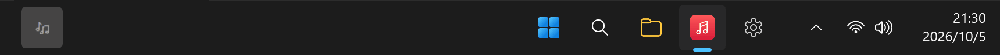

# 任务栏歌词（Taskbar Lyrics）

[](https://github.com/ChissaQAQ/TaskbarLyrics/releases/latest)
[](https://github.com/ChissaQAQ/TaskbarLyrics/releases)
[](https://github.com/ChissaQAQ/TaskbarLyrics/actions/workflows/build.yml)
[](LICENSE)

在 Windows 任务栏里显示正在播放的歌的歌词。歌词条是任务栏的子窗口，不是浮在上面的悬浮窗。



## 下载

在 [Releases](https://github.com/ChissaQAQ/TaskbarLyrics/releases/latest) 下载 `TaskbarLyrics.exe`，双击运行，不用安装。

需要先装 [.NET 10 Desktop Runtime](https://dotnet.microsoft.com/download/dotnet/10.0)，没装的话程序会提示。

更新记录见 [CHANGELOG.md](CHANGELOG.md)。

### 前提：播放器必须打开「系统媒体控件（SMTC）」上报

程序通过 Windows 的系统媒体控件（SMTC）知道你在听什么。播放器没开这个上报的话，歌词条会一直显示「暂无歌词」。

检查方法：播放时按一下音量键，系统弹出的媒体浮层里能看到歌名和封面就没问题。

看不到的话去播放器设置里找，一般在「设置 → 播放」下面，名字类似「在系统媒体控件中显示」。网易云音乐和 QQ 音乐的部分版本默认是关的。Spotify 和浏览器默认会上报，不过浏览器在程序的黑名单里，要用的话在设置里取消屏蔽。

## 功能

- 任务栏模式和浮动窗口模式
- 宽度跟着歌词长短变，也可以自动避开任务栏图标
- 逐字高亮（酷狗 KRC），太长的行会跟着进度横向滚动
- 双行显示：外文歌下行是译文或罗马音，中文歌下行是下一句
- 鼠标移上去显示封面、上一首 / 播放 / 下一首和歌名
- 专辑封面
- 过滤作词、作曲这类制作信息
- 文字颜色跟随系统深浅色，也可以自定义
- 居中或左对齐
- 全屏时自动隐藏
- 单曲循环时歌词会重新开始
- 播放器黑名单
- 自动检查更新，一键更新
- 歌词缓存到本地（30 天，最多 400 首），听过的歌断网也有词
- 锁定位置后鼠标穿透
- 听歌统计：累计听了多久、每天 / 周 / 月的时长、最常听的歌 / 歌手 / 专辑（按次数或时长排）、新发现的歌、一天里和一周里什么时候听，还有几张趣味小卡片；可以只看某个播放器
- 年度听歌报告，统计页和年报都能存成图片或复制去分享（图里没有文件路径）
- 统计页和年报的榜单配专辑封面、歌手头像
- 托盘图标

设置保存在 exe 旁边的 `config.json`，删掉就恢复默认。如果那个目录不能写（比如放在 Program Files 里），会改存到 `%AppData%\TaskbarLyrics\`。

听歌统计记在 `config.json` 旁边的 `stats` 文件夹里，一个月一个文件，只存在本机，不上传。设置里可以关掉记录，也可以一键清空。每段记录有：开始时间和时区、听了多久、歌名、歌手、播放器，以及播放器报了的专辑、专辑歌手、曲目号、流派、随机 / 循环模式、歌曲时长和播放进度、这段为什么结束（暂停、切歌之类），还有歌词库里匹配到的歌曲 id 和专辑。

统计页的封面和头像是播放时顺带存的：一首歌听满 8 秒后，封面优先用播放器给的那张，没有再从歌词的同一来源（网易云 / QQ 音乐）下载，歌手头像也从那里来。图存在 `config.json` 旁边的 `art-cache` 文件夹，打开统计页不联网，以前听的歌不会补图。设置里可以关掉，清空听歌记录时一起清掉。

## 原理

- 歌名、歌手和播放状态从 SMTC 读。网易云不报播放进度，所以进度是本地计时算的
- 歌词依次从网易云、QQ 音乐、LRCLIB 找，逐字时间轴来自酷狗 KRC
- 用 `SetParent` 把窗口挂进任务栏（主屏 `Shell_TrayWnd`，副屏 `Shell_SecondaryTrayWnd`）

## 已知问题

- 拖进度条感知不到，歌词会接着按原来的节奏走，换首歌就好了
- 程序启动前就在放的歌，从启动那一刻开始计时
- 罗马音只有网易云有

## 开发

```powershell
dotnet build wpf/TaskbarLyrics -c Release

# 先关掉正在运行的程序，不然 exe 被占用会报 MSB4018
Stop-Process -Name TaskbarLyrics -Force -ErrorAction SilentlyContinue
dotnet publish wpf/TaskbarLyrics -c Release -r win-x64 --self-contained false `
  -p:PublishSingleFile=true -o wpf/publish

# 测试歌词抓取（不读缓存）。时长秒可省略，网易云客户端不报时长
wpf/publish/TaskbarLyrics.exe --lyrics-test "歌名" "歌手" [translation|romaji|off] [时长秒]

# 测试检查更新
wpf/publish/TaskbarLyrics.exe --update-test

# 听歌统计自测：不带参数跑断言；report 对本机真实记录出文字报告；
# shot 把统计窗口、分享图、年度报告渲染成 PNG，浅色深色各一套（默认合成数据，加 real 用真实记录）
wpf/publish/TaskbarLyrics.exe --stats-test [report | shot <目录> [real]]
```

代码在 `wpf/TaskbarLyrics/`：

| 文件 | 内容 |
| --- | --- |
| `MainController.cs` | 主循环，读 SMTC、找当前行、交给界面 |
| `SmtcListener.cs` | 监听系统媒体控件 |
| `Lyrics.cs` | 抓歌词、选版本、对齐译文和逐字时间 |
| `LyricsCache.cs` | 歌词缓存 |
| `OverlayWindow.xaml(.cs)` | 歌词显示和动画 |
| `NativeMethods.cs` | 挂进任务栏、置顶、鼠标穿透 |
| `TaskbarFreeSpace.cs` | 计算任务栏上的空位 |
| `SettingsWindow.xaml(.cs)` / `TrayIcon.cs` / `AppConfig.cs` | 设置、托盘、配置 |
| `Updater.cs` | 检查和安装更新 |
| `ListenStats.cs` | 记录听歌片段、读写统计文件 |
| `StatsReport.cs` / `StatsWindow.xaml(.cs)` | 汇总统计、统计窗口 |
| `ArtCollector.cs` / `ArtCache.cs` | 播放时收集封面和头像、本地图片缓存 |
| `YearReportWindow.xaml(.cs)` / `ShareImage.cs` | 年度报告、把界面存成分享图 |
| `StatsSelfTest.cs` | 听歌统计的控制台自测 |

不少看着多余的写法是为了绕开 Windows 的坑，注释里有写原因，改之前可以先看看。

## 反馈

有问题可以提 [Issue](https://github.com/ChissaQAQ/TaskbarLyrics/issues)。提之前先确认 SMTC 是通的，再附上程序、Windows 和播放器的版本。歌词有问题的话请写上歌名和歌手。

## 许可

代码使用 [MIT](LICENSE) 许可。

歌词、专辑封面和歌手头像来自网易云音乐、QQ 音乐、LRCLIB 和酷狗的公开接口，版权归原权利方。本地缓存只是为了少发请求：歌词 30 天后过期，图片超过 1500 张时先删最久没看的。仅供个人使用。
